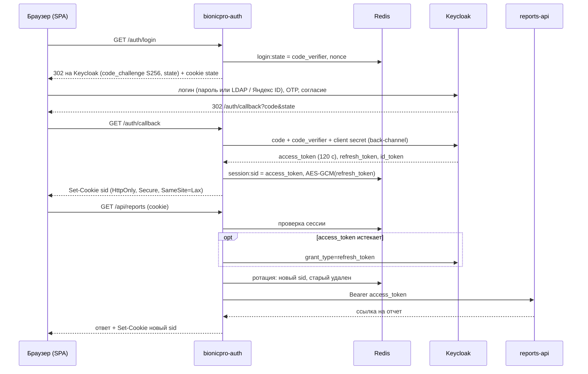

# BionicPRO: проектная работа 9 спринта

Безопасность (SSO, PKCE, BFF, LDAP, MFA, Яндекс ID), сервис отчетов (Airflow + ClickHouse),
кеширование отчетов (S3 + CDN) и CDC (Debezium + Kafka + ClickHouse KafkaEngine).

## Состав репозитория

| Путь | Назначение | Задание |
| --- | --- | --- |
| `docs/task1_security_c4.drawio` | C4-диаграмма: управление учетными данными, токенами, внешние IdP | 1.1 |
| `docs/task2_reports_c4.drawio` | C4-диаграммы: ETL и сервис отчетов (стр. 1), S3/CDN и CDC (стр. 2) | 2.1, 3, 4 |
| `bionicpro-auth/` | BFF: Authorization Code + PKCE, сессии, токены в Redis, refresh, ротация session id | 1.2, 1.3 |
| `frontend/` | React SPA без keycloak-js, работает только с HttpOnly-cookie; кнопка отчета | 1.3, 2.5 |
| `keycloak/realm-export.json` | Исходный realm (access_token 120 c, PKCE для reports-frontend) | 1.2, 1.3 |
| `keycloak/configure/configure.py` | Идемпотентная настройка realm: клиенты, LDAP, OTP, Яндекс ID, экспорт | 1.2-1.6 |
| `keycloak/keycloak-results-export.json` | Экспорт realm после всех настроек (секреты замаскированы Keycloak) | 1 |
| `ldap/config.ldif` | Пользователи и группы LDAP представительства | 1.4 |
| `crm/init.sql`, `telemetry/init.sql` | Схемы и тестовые данные CRM и телеметрии (PostgreSQL) | 2 |
| `clickhouse/init/` | Схема OLAP: raw-слой, витрина `report_daily`, watermark, пользователи | 2 |
| `airflow/` | DAG `bionicpro_reports_etl` (ETL по расписанию) | 2.2 |
| `reports-api/` | API `/reports`: JWT, RBAC, только свой отчет, S3 + CDN | 2.3, 2.4, 3 |
| `nginx/cdn.conf` | Nginx как CDN: reverse proxy к Minio с кешированием | 3 |
| `debezium/` | Конфигурация Debezium-коннектора CRM и скрипт регистрации | 4 |
| `clickhouse/cdc/` | KafkaEngine, MaterializedView, витрина `report_daily_cdc` | 4 |
| `docker-compose.yaml` | Развертывание всего стенда | все |
| `tests/e2e_check.py` | End-to-end проверка без браузера | все |

## Запуск

Требования: Docker с Compose v2, около 6 ГБ RAM для полного стенда.

```bash
cp .env.example .env
```

В `.env` задать секреты (`openssl rand -base64 32` для `TOKEN_ENC_KEY`), а также
`YANDEX_CLIENT_ID` / `YANDEX_CLIENT_SECRET` приложения Яндекс ID
(redirect URI: `http://localhost:8080/realms/reports-realm/broker/yandex/endpoint`).

```bash
docker compose --profile airflow --profile cdc up -d --build
```

Профили позволяют поднимать стенд частями:

| Команда | Что поднимается |
| --- | --- |
| `docker compose up -d` | Keycloak, LDAP, Redis, bionicpro-auth, фронтенд, CRM, телеметрия, ClickHouse, reports-api, Minio, CDN |
| `--profile airflow` | + Airflow (ETL и витрина) |
| `--profile cdc` | + Kafka, Kafka Connect (Debezium), прием в ClickHouse |

Режимы (переменные в `.env`):

- `CRM_SOURCE=airflow|cdc` - откуда DAG берет CRM: выгрузка из PostgreSQL (задание 2) или CDC (задание 4).
- `REPORT_SOURCE=airflow|cdc` - какую витрину читает reports-api: `report_daily` или `report_daily_cdc`.

По умолчанию стенд в целевом режиме задания 4 (`cdc`). Режим задания 2:

```bash
CRM_SOURCE=airflow REPORT_SOURCE=airflow docker compose --profile airflow up -d
```

Адреса:

| Сервис | URL | Учетные данные |
| --- | --- | --- |
| Фронтенд | http://localhost:3000 | prothetic1 / prothetic123, john.doe / password (LDAP) |
| Keycloak | http://localhost:8080 | admin / admin |
| Airflow | http://localhost:8082 | admin / admin |
| Minio console | http://localhost:9001 | minioadmin / minioadmin |
| CDN | http://localhost:8081 | - |
| ClickHouse HTTP | http://localhost:8123 | см. `.env` |

При первом входе Keycloak требует настроить OTP (Google Authenticator / FreeOTP) и дать согласие
на использование данных профиля.

## Задание 1. Повышение безопасности

### Архитектура

Диаграмма: `docs/task1_security_c4.drawio`.

- Keycloak - единая точка входа и Identity Broker.
- Пользователи представительств берутся из LDAP в стране представительства (User Federation, READ_ONLY),
  группы LDAP отображаются в роли realm.
- Внешние IdP разных стран подключаются через Identity Brokering (Яндекс ID - OAuth 2.0, остальные - OIDC/SAML).
- Персональные и медицинские данные хранятся в контуре своей страны. Для стран со строгой локализацией
  разворачивается региональный контур (Keycloak + БД + LDAP в стране), между контурами передаются
  только псевдонимизированные claims.
- Токены IdP не попадают во фронтенд: их получает и хранит BFF `bionicpro-auth`.

### Поток аутентификации (PKCE + BFF)



### Что реализовано

| Требование | Реализация |
| --- | --- |
| PKCE вместо Code Grant | `bionicpro-auth/app/pkce.py`, `main.py:/auth/login`; в Keycloak `pkce.code.challenge.method=S256` для `bionicpro-auth` и `reports-frontend` |
| Токены на бэкенде | `bionicpro-auth` - конфиденциальный клиент; access_token в Redis, refresh_token в Redis под AES-256-GCM (`crypto.py`) |
| access_token =< 2 мин | `accessTokenLifespan=120` (realm-export и configure.py); SSO idle 30 мин > 2 мин |
| Cookie вместо токенов | `bionicpro_session`: HttpOnly, Secure, SameSite=Lax; фронтенд без keycloak-js |
| Авто-refresh | `_require_session`: обновление за 15 c до истечения access_token |
| Ротация session id | новый sid на каждый запрос к `/auth/me` и `/api/*`, старый удаляется (10 c grace для параллельных запросов) |
| LDAP | OpenLDAP (`openldap`), User Federation `ldap-bionicpro-eu`, маппер групп -> ролей realm, атрибут `representation` |
| MFA | flow `browser-mfa` с обязательным OTP Form, `CONFIGURE_TOTP` - default action, `post-broker-otp` для внешних IdP |
| Яндекс ID | generic OAuth 2.0 provider (PKCE), мапперы профиля в атрибуты пользователя (БД Keycloak), consent на клиенте |
| Экспорт realm | `keycloak/keycloak-results-export.json` (создается `keycloak-config` после настройки) |

## Задание 2. Сервис отчетов

Диаграмма: `docs/task2_reports_c4.drawio`, страница 1.

- DAG `airflow/dags/bionicpro_reports_etl.py`, расписание `0 * * * *` (каждый час).
- Инкрементальная загрузка телеметрии по `received_at` в интервале `(watermark, data_interval_end]`,
  поэтому опоздавшие данные с протезов тоже попадают в витрину.
- Витрина `reports.report_daily`: одна строка = клиент x день x протез, `ORDER BY (customer_email, report_date, prosthesis_serial)`.
- `reports.etl_watermark` - граница обработанных данных. API отдает только полностью обработанные дни,
  для необработанного периода возвращает 409, период частично за границей обрезается (`truncated=true`).
- Доступ: JWT (подпись, `iss`, `aud=reports-api`), роль `prothetic_user`, email берется только из токена,
  запрос чужого отчета -> 403, без аутентификации -> 401.

Ручной запуск DAG до текущего момента:

```bash
docker compose exec airflow airflow dags trigger bionicpro_reports_etl -c '{"until": "now"}'
```

## Задание 3. S3 и CDN

Диаграмма: `docs/task2_reports_c4.drawio`, страница 2.

- Ключ отчета: `reports/<HMAC(email)>/<data_version>/<from>_<to>.json`, `data_version` - watermark ETL.
- Запрос отчета: `HEAD` в S3 -> есть -> подписанная ссылка через CDN без обращения к ClickHouse;
  нет -> запрос в витрину, `PUT` в S3, ссылка.
- Обновление кеша: после нового прогона ETL меняется `data_version`, а значит и URL. Объект по старому
  пути не меняется, поэтому кеш CDN не нужно инвалидировать. Старые объекты удаляет lifecycle Minio (7 дней),
  старые записи nginx вытесняются по `inactive`.
- CDN (`nginx/cdn.conf`): кеш по пути без параметров подписи, `proxy_cache_valid 200 10m`, ошибки не кешируются,
  заголовок `X-Cache-Status`.
- Официальные образы `minio/minio` больше не публикуются в Docker Hub, поэтому используется
  `bitnamilegacy/minio` того же релиза Minio.

## Задание 4. CDC

Диаграмма: `docs/task2_reports_c4.drawio`, страница 2.

- `crm-db` запущен с `wal_level=logical`, таблицы с `REPLICA IDENTITY FULL`.
- `debezium/crm-connector.json`: PostgreSQL connector (pgoutput), `ExtractNewRecordState`, JSON без схемы,
  креды БД через `FileConfigProvider`; регистрация - `debezium/register-connector.sh`.
- Kafka 3.8 (KRaft) и Kafka Connect описаны в `docker-compose.yaml`.
- `clickhouse/cdc/01_kafka_engine.sql`: таблицы KafkaEngine -> MaterializedView -> `crm_*_cdc`
  (`ReplacingMergeTree(_version, is_deleted)`).
- `clickhouse/cdc/02_report_mart_mv.sql`: витрина `report_daily_cdc` (AggregatingMergeTree), MaterializedView
  на вставки телеметрии с JOIN на протезы из CDC.
- reports-api переведен на новую витрину (`REPORT_SOURCE=cdc`), DAG в режиме `crm_source=cdc`
  не обращается к БД CRM.

## Проверка

```bash
pip install requests pyotp
python tests/e2e_check.py
python tests/e2e_check.py --only auth --with-refresh
```

Тест эмулирует браузер: PKCE-логин, настройку и ввод TOTP, согласие, проверяет флаги cookie, ротацию
session id, refresh access_token, logout, роли из LDAP, отчеты, кеш S3, кеш CDN, ограничение доступа.

## Особенности и ограничения стенда

- Стенд работает по HTTP на `localhost`: браузеры считают его безопасным контекстом и принимают cookie
  с флагом `Secure`. В продуктиве перед сервисами нужен TLS.
- Вход через Яндекс ID проверяется вручную в браузере (нужна реальная учетная запись Яндекса).
  Автотест проверяет только перенаправление на `oauth.yandex.ru`.
- Если Keycloak временно недоступен во время refresh, bionicpro-auth возвращает 503 и сохраняет сессию.
  Если refresh_token отозван или истек, сессия удаляется и возвращается 401.
- Healthcheck Kafka проверяет только TCP-порт: запуск `kafka-*.sh` раз в 10 секунд стартует отдельную JVM
  и на машине с 4 CPU заметно замедляет остальные сервисы, включая Keycloak.
- nginx фронтенда и CDN резолвит адреса контейнеров через Docker DNS (`resolver 127.0.0.11`), поэтому
  пересоздание `bionicpro-auth` или `minio` не требует перезапуска nginx.
